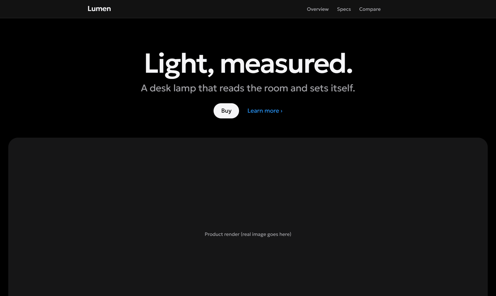
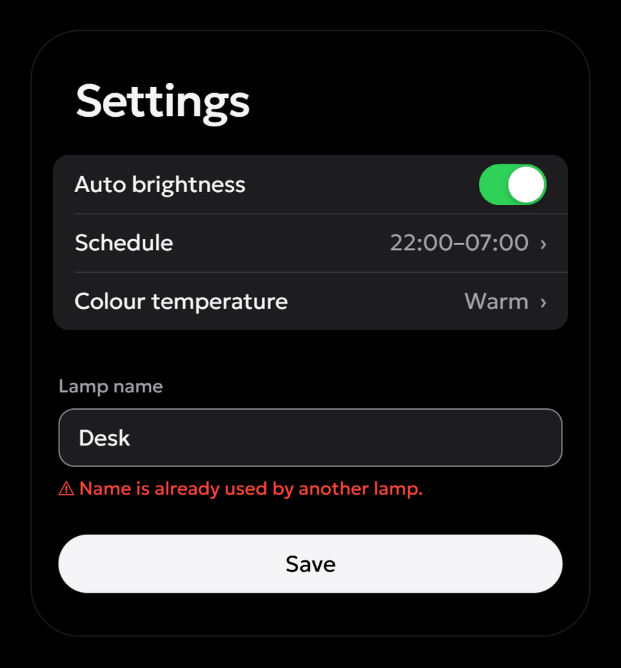
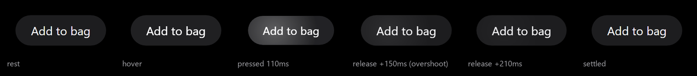
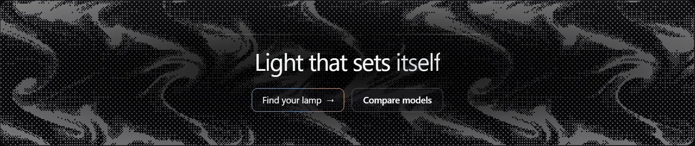
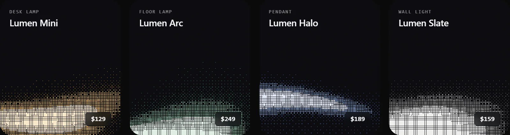
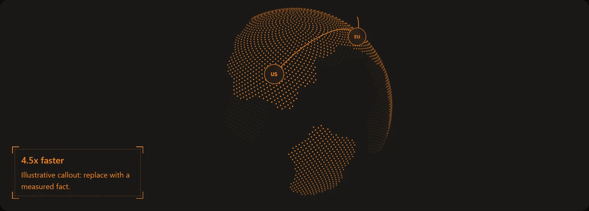
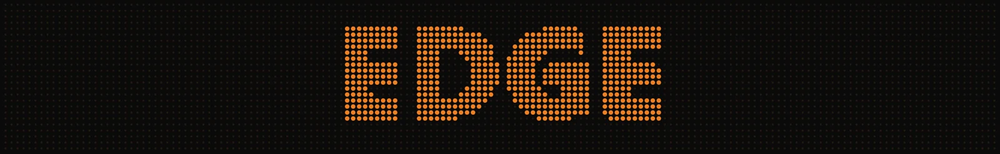

# Better Design — скилл UI/UX-дизайна для ИИ-агентов

**[▶ Живое демо](https://moddingflow.github.io/better-design/)**: один и тот же запрос со скиллом и без него, рядом, плюс встроенные живые страницы. Можно попробовать до установки.

[English](README.md) · [Установка](docs/installation.md) · [Примеры запросов](docs/examples.md) · [Проверки](docs/validation.md) · [История версий](CHANGELOG.md)

**Better Design** даёт ИИ-агенту последовательный процесс работы над интерфейсом: визуальная концепция из задачи продукта, общая система в `DESIGN.md`, выверенная геометрия, элементы управления, которые по-настоящему откликаются на нажатие, доступные действия и проверка реального результата.



<sub>Эталон стиля по умолчанию из [`assets/house-style.html`](skills/better-design/assets/house-style.html). Продукт условный: агент подставляет реальные тексты и изображения.</sub>

Скилл предназначен для сайтов, веб-приложений, нативных и десктопных интерфейсов, а также игрового UI. Его можно установить через Skills CLI для **Codex, Claude Code, Cursor** и других агентов, поддерживающих Agent Skills.

## Быстрый старт

В каталоге своего проекта выполните:

```sh
npx skills add Moddingflow/better-design --skill better-design
```

Выберите агента в установщике. Затем напишите:

```text
Используй better-design, чтобы улучшить экран настроек аккаунта.
Сначала прочитай DESIGN.md. Сохрани бренд и текущую структуру приложения.
Проверь состояния загрузки, ошибки, повторную попытку, клавиатуру и мобильную
версию. В конце укажи, что действительно проверено, а что осталось непроверенным.
```

Самому скиллу не нужны API-ключи, MCP-сервер или установка зависимостей в приложение. Для установщика нужны Node.js и Git. Для необязательных проверок — Python 3.10+ (валидаторы контрактов, токенов и геометрии) и Node.js 22+ с Chrome, Chromium или Edge (пробник анимаций). Требования и доступ к выбранному ИИ-агенту остаются отдельными.

## Установка для конкретного агента

Выберите подходящую команду:

```sh
# Codex, для текущего проекта
npx skills add Moddingflow/better-design --skill better-design --agent codex

# Claude Code, для текущего проекта
npx skills add Moddingflow/better-design --skill better-design --agent claude-code

# Cursor, для текущего проекта
npx skills add Moddingflow/better-design --skill better-design --agent cursor
```

Добавьте `--global`, чтобы использовать скилл в разных проектах, или `--copy`, если в Windows недоступны символьные ссылки. Установку для проекта запускайте из его корневой папки.

Для ручной установки скачайте репозиторий и скопируйте **всю папку** `skills/better-design` в каталог скиллов своего агента. Одного `SKILL.md` недостаточно: он ссылается на справочники, шаблоны, наборы анимаций и скрипты. Если агент не видит новый скилл, обновите его список скиллов или начните новый чат.

Подробности: [установка, фиксированная версия и устранение проблем](docs/installation.md). Команды основаны на документации [Skills CLI](https://github.com/vercel-labs/skills). Совместимость формата и установки не означает, что качество результата проверено на каждой модели.

## Что умеет скилл

| Направление | Требуемый подход |
| --- | --- |
| Арт-дирекшен | Концепция из предметной области продукта, реальные референсы, сравнение направлений и объяснение выбора. |
| Стиль по умолчанию | Если нет ни указаний, ни своей системы — премиальный ультраминимализм вместо догадок: чёрный фон, светлый Geologica, два серых, один синий для ссылок и фокуса. |
| Дизайн-система | Чтение `DESIGN.md`, общие токены и согласованные значения в документации и коде. |
| Геометрия макета | Равные отступы, общие линии выравнивания, центрирование по видимому начертанию, ничего не обрезано и не прилипает к краю — с замером, а не на глаз. |
| Движение | Каждый элемент получает настоящий отклик на нажатие, ховер, фокус и переходы состояний из встроенного набора; результат проверяет пробник в headless-браузере. |
| Поведение | Загрузка, ошибки, восстановление, сохранение введённых данных и наблюдаемый результат действий. |
| Загрузка файлов | Drop zone, выбор кнопкой, подсветка перетаскивания, ограничения, прогресс, превью и повторная попытка. |
| Фирменные эффекты | Необязательный пул проверенных эффектов (дизеринг, «точечный язык», сцены при прокрутке) для экранов, чья концепция этого требует. |
| Доступность | Клавиатура, видимый фокус, имена элементов, контраст, масштабирование текста, уменьшенное движение и альтернативы жестам. |
| Проверка | Актуальный интерфейс и реальные сценарии; отдельно выполненные и недоступные проверки. |
| Текст интерфейса | Удаление пересказа назначения страницы, описаний, повторяющих название тумблера, одного и того же факта дважды на экране и пояснений без новой информации. |

Каталог типичных шаблонных решений содержит признаки, замены и допустимые исключения. Существующий бренд и дизайн-система всегда сохраняются; стиль по умолчанию включается только тогда, когда опереться не на что.

## Стиль по умолчанию

Если вы не задали визуального направления, а в проекте нет `DESIGN.md`, бренда, токенов или готового интерфейса, агент делает интерфейс в **стиле по умолчанию** — премиальном ультраминимализме в духе продуктовых страниц и системных приложений Apple. Любое ваше указание — цвета, настроение, тема, сайт-образец, бренд, «игривый», «для детей» — его заменяет. Существующий продукт в этот стиль без просьбы не перекрашивается.

<table>
<tr>
<td width="58%" valign="top">

- **Цвет:** фон `#000`, текст `#f5f5f7`, вторичный `#a1a1a6`, синий только для ссылок и фокуса. Цвет на странице дают реальные изображения. Все 44 пары контраста (тёмная и светлая тема) проходят встроенный валидатор.
- **Шрифт:** Geologica, облегчённая и плотная: заголовки 500 с трекингом −0.035 em, текст 340, мелкий текст и кнопки 400.
- **Форма:** кнопки-таблетки, скругления 28 / 18 / 12 px, поверхности различаются тоном, а не рамками и тенями.
- **Сдержанность:** одно главное действие на экран, каждый факт один раз (нет названия продукта и в шапке, и над заголовком, нет двух «Купить»).
- **Готово к копированию:** заполненный [пресет `DESIGN.md`](skills/better-design/assets/DESIGN.house-style.md), [правила](skills/better-design/references/house-style.md) и [эталонная страница](skills/better-design/assets/house-style.html).

</td>
<td width="42%" valign="top">



</td>
</tr>
</table>

## Кнопки, которые отвечают на нажатие

Без подсказки агенты делают кнопки, которые при нажатии не меняются вовсе или сдвигаются на 1px и сразу возвращаются. Better Design делает анимации частью сборки, а не «полировкой потом»: агент подключает [набор интерактивных анимаций](skills/better-design/assets/motion/) до того, как начнёт собирать компоненты.



- **Нажатие в три слоя.** За 90 мс элемент проседает примерно на 4px по периметру (глубина зависит от размера), заливка меняется на ступень, от точки касания расходится мягкая подсветка. При отпускании он возвращается пружиной с перелётом около 1% и успокаивается за ~450 мс.
- **Быстрый тап виден.** Нажатое состояние держится минимум 90 мс, поэтому даже тап в 40 мс на телефоне заметен. Пробел и Enter дают тот же отклик.
- **Остальной набор:** ховер без «подъёма», кольцо фокуса, которое плавно появляется, переключатель с растягивающимся бегунком, чекбокс с рисующейся галочкой, скользящий индикатор табов, кнопки «загрузка → готово → ошибка» без скачков ширины, смена иконок, меню, растущие из своей кнопки, и плавно раскрывающиеся блоки. В режиме «уменьшить движение» остаётся весь отклик, кроме перемещений.

Затем это проверяет **пробник анимаций**. Он запускает headless Chrome, наводит курсор, зажимает (и отпускает за пределами элемента, поэтому ничего не срабатывает) и фокусирует с клавиатуры каждый элемент:

```console
$ node skills/better-design/scripts/motion_probe.mjs page-without-motion.html
elements: 4  errors: 5  warnings: 10
  ---  control     button "Dead button"
  P--  control     button "1px button"
  …
ERRORS
  button "Dead button": no press feedback within 60 ms
  button "Dead button": no visible focus style
  …
WARNINGS
  button "1px button": weak press: only a 1–2 px move or a tiny scale; add a fill step or bloom and a spring release (interaction kit)
  …

$ node skills/better-design/scripts/motion_probe.mjs skills/better-design/assets/motion/kit.html
elements: 20  errors: 0  warnings: 0
```

Ошибки пробника — или пробник, который не запускали на созданной странице, — скилл считает проваленной приёмкой.

## Необязательный пул эффектов

Для выразительных экранов, чья концепция требует фирменной детали, есть [библиотека эффектов](skills/better-design/references/effects-library.md): проверенные рецепты без зависимостей, правила применения, лимиты на страницу, запасные варианты и режим уменьшенного движения. Ничего из этого не включается по умолчанию. Приёмы изучены на Cloudflare, Linear и продуктовых страницах Apple и написаны заново по наблюдаемому поведению.









- **Дизеринг:** живое WebGL-поле и «запечённый» полутон без нагрузки для наборов карточек.
- **Точечный язык:** сетка точек с прожектором под курсором, любая картинка или текст из точек, точечный глобус с маршрутами, бегущая волна по полосе точек, данные столбиками из точек и LED-иконки 5×5.
- **Структура и свет:** чертёжные линии, «болты» на углах и уголки-скобки, комета по рамке активной карточки, свет вокруг главной кнопки, серебряный перелив, плёночное зерно.
- **Взаимодействие и прокрутка:** шапка, превращающаяся в капсулу, карусель с масштабом по расстоянию, линейка-таймлайн, стопка карточек, точечная навигация с таймером, затухание краёв списков, zoom медиа и смена темы секций.

У каждого эффекта есть демо: [`assets/effects/gallery.html`](skills/better-design/assets/effects/gallery.html).

## Четыре режима работы

**Создание**

```text
Используй better-design для создания страницы записи в скалодром.
Основная задача — выбрать занятие и забронировать место. Определи визуальное
направление, поддержи телефон и десктоп, реализуй загрузку, ошибки и подтверждение.
```

**Локальное улучшение**

```text
Используй better-design, чтобы улучшить загрузку аватара.
Сохрани текущую вёрстку и API. Добавь понятные состояния перетаскивания,
ошибки формата и размера, прогресс, превью и повторную попытку.
```

**Аудит без изменений**

```text
Используй better-design для аудита экрана оплаты. Не меняй файлы.
Для каждого замечания укажи важность, доказательство, затронутую задачу
пользователя и минимальное исправление.
```

**Планирование**

```text
Используй better-design, чтобы спланировать редизайн игрового инвентаря.
Пока ничего не реализуй. Сохрани арт-дирекшен и UI-стек. Учти мышь,
клавиатуру, геймпад, длинные названия предметов и возврат назад.
```

## Что сообщить агенту

- Какую задачу должен выполнить пользователь интерфейса.
- Какой экран, маршрут или компонент нужно изменить.
- Что сохранить и разрешено ли редактировать код.
- Нужен ли определённый визуальный стиль; без указаний будет стиль по умолчанию.
- Какие устройства, размеры, языки и способы ввода поддерживаются.
- Где находятся `DESIGN.md`, токены, текущая реализация и референсы.
- Как запустить приложение и проверить сценарии на безопасных данных.

## Состав репозитория

- [SKILL.md](skills/better-design/SKILL.md) — основной процесс на английском.
- [Справочники](skills/better-design/references/) — 14 подробных руководств на английском: арт-дирекшен, стиль по умолчанию, геометрия, движение, эффекты, поведение, платформы, приёмка и источники.
- [Шаблон DESIGN.md](skills/better-design/assets/DESIGN.template.md) и [пресет стиля по умолчанию](skills/better-design/assets/DESIGN.house-style.md).
- [Набор интерактивных анимаций](skills/better-design/assets/motion/) — CSS и JS, демо-стенд и памятка по переносу в React, Vue, Svelte и нативные приложения.
- [Пул эффектов](skills/better-design/assets/effects/) — CSS и JS с демо-галереей.
- [Сборщики раскладки](skills/better-design/assets/layout-dump/) для веба, Unity и Godot.
- [Валидаторы, пробник и тесты](skills/better-design/scripts/) — необязательные инструменты на Python и Node.js.

Начиная с версии 1.1.0 весь устанавливаемый скилл на английском, включая справочники, шаблоны, примеры и метаданные. Русские строки в Python-тестах сохранены специально для проверки Unicode. Эта русская инструкция предназначена для читателей; язык создаваемого интерфейса задаётся вашим проектом.

## Фильтрация лишнего текста

Страница настроек должна показывать настройки. Под тумблером «Тёмная тема» не нужно писать «Включите или выключите тёмную тему». Правила проверяют не совпадение слов, а повторение смысла — в том числе один и тот же факт дважды на одном экране.

Для каждого пояснения агент должен определить, какую конкретную информацию потеряет пользователь после его удаления. Если это только пересказ заголовка или подписи — текст удаляется вместе с пустым контейнером. Если пояснение сообщает реальные ограничения, последствия, стоимость, требования или способ исправить ошибку — оно сохраняется. Выдумывать факты ради заполнения описания запрещено.

## Необязательные проверки

После клонирования выполните из корня репозитория:

```sh
# Контракты и токены (Python 3.10+, только стандартная библиотека)
python -B -X utf8 skills/better-design/scripts/validate_design.py contract skills/better-design/assets/design-contract.example.json --json
python -B -X utf8 skills/better-design/scripts/validate_design.py tokens skills/better-design/assets/house-style.tokens.json --require-contrast --json

# Геометрия отрисованного экрана (сначала снимите раскладку сборщиком из assets/layout-dump)
python -B -X utf8 skills/better-design/scripts/check_layout.py skills/better-design/assets/layout.example.json

# Нажатие, ховер и фокус каждого элемента (Node.js 22+ и Chrome/Chromium/Edge)
node skills/better-design/scripts/motion_probe.mjs skills/better-design/assets/motion/kit.html
node skills/better-design/scripts/motion_probe.mjs http://localhost:5173 --width 390 --height 844 --reduced-motion

# Регрессионные тесты
python -B -X utf8 skills/better-design/scripts/test_validate_design.py
python -B -X utf8 skills/better-design/scripts/test_check_layout.py
```

Python-инструменты читают только переданный JSON, не изменяют проект и не обращаются в сеть. Пробник открывает указанную страницу во временном профиле headless-браузера, ничего не нажимает по-настоящему и удаляет профиль после работы.

**Успешная проверка не доказывает качество UX, контраст отрисованного интерфейса, полное соответствие WCAG или готовность к выпуску.** Реальные устройства, вспомогательные технологии и сценарии пользователей нужно проверять отдельно.

Коды возврата: `0` — перечисленные проверки прошли; `1` — найдены ошибки; `2` — ошибка чтения, разбора или аргументов. Подробнее: [справочник проверок](skills/better-design/references/validation.md).

## Обновление и удаление

Для установки через Skills CLI:

```sh
npx skills list
npx skills update better-design
npx skills remove better-design
```

При работе с глобальной установкой добавьте `--global`. Сохраните собственные изменения перед обновлением. Для ручной установки обновляйте или удаляйте только точную папку этого скилла.

## Ограничения и лицензия

Скилл не содержит компонентной библиотеки и не требует React или Tailwind: набор анимаций и эффекты — это небольшие рецепты на CSS и JS, которые агент переносит в ваши компоненты. Он не заменяет экспертизу дизайнера. Результат зависит от модели, задачи, контекста и доступных инструментов проверки. Публичного сравнительного теста качества по разным агентам пока нет.

Код и инструкции распространяются под [MIT](LICENSE), включая коммерческое использование с сохранением уведомления о лицензии. Шрифт Geologica распространяется под SIL Open Font License 1.1. Источники и концептуальные влияния перечислены [отдельно](skills/better-design/references/sources.md).

[Как внести улучшение](CONTRIBUTING.md) · [История версий](CHANGELOG.md) · [Сообщить о проблеме](https://github.com/Moddingflow/better-design/issues)
