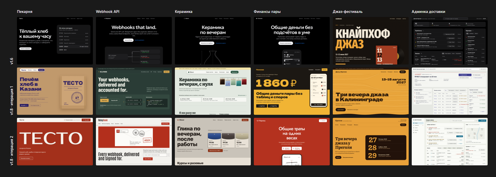

# Bench: v1.6 against v1.8 on briefs with no visual direction

v1.8 changes what the agent does when nobody chose a look. This bench checks whether that
change makes unrelated products stop converging on one page, and whether the pages are
better, not just different. All built pages are live in the
[demo](https://moddingflow.github.io/better-design/#v18) (`demo/bench/`).

## Setup

- **Briefs**, one line each, no visual cue, an empty project folder:
  1. «Сделай лендинг для небольшой пекарни «Тесто» в Казани.» (a small bakery in Kazan)
  2. "Make a landing page for Relayhook, a webhook delivery API for developers."
  3. «Нужен сайт для школы керамики для взрослых.» (an adult ceramics school)
  4. «Сделай лендинг мобильного приложения для учёта общих финансов пары.» (a couples' shared-finance app)
  5. «Сайт для небольшого джазового фестиваля в Калининграде.» (a small jazz festival)
  6. «Сделай главный экран админки для диспетчера службы доставки: заказы, курьеры, проблемы.» (a dispatcher admin)
- **Arms:** a frozen copy of v1.6 and of v1.8, each read from its own path by a fresh agent
  per brief, with no shared context and no skill auto-loading. Same constraints for both:
  one self-contained page, no external images, no invented facts, the user unavailable.
  Model: Claude Opus 5.5.
- **v1.8 ran twice.** Iteration 1 exposed problems; they were fixed and iteration 2 is what
  ships. Iteration 2's rotation log was seeded with iteration 1's six builds, as if they were
  the user's previous projects.
- **Measures:** `scripts/bench_metrics.mjs` (render in headless Chrome, convergence across
  pages, a mechanical subset of the slop catalog) and two blind judges: fresh agents who saw
  only unlabeled desktop and phone first screens in random A/B order, scored six axes 1–5
  and an overall 1–10, picked the page a design lead would ship, and grouped all first
  screens into clusters that "look like one site with different words".

## Results

| | v1.6 | v1.8, iteration 1 | v1.8, iteration 2 (shipped) |
| --- | --- | --- | --- |
| Pages a blind judge grouped into one template | 5 of 6 (both judges) | 0 | 0 |
| Distinct display typefaces | 2 | 4 | 6 |
| Hero colour distance, mean pairwise (0–1, higher is more varied) | 0.12 | 0.85 | 0.77 |
| Mechanical slop flags per page | 1.83 | 0.83 | 0 |
| Words on the first screen, mean | 78 | 108 | 84 |
| Pairs won against v1.6 (blind) | | 3 of 6 | 4 of 6 |
| Overall, mean of 10 (blind) | 6.33 (judge 1) · 5.83 (judge 2) | 6.33 | 6.83 |
| Variety / execution, mean of 5 (blind) | 2.0 / 3.8 (judge 1) · 1.8 / 4.0 (judge 2) | 4.2 / 3.0 | 3.2 / 3.7 |

v1.6's flags were arrows glued to link text, an em dash in every sentence, an eyebrow,
tracked-capital labels, an accented headline word, numbered section labels, a radial glow,
and middle-dot meta strings. Iteration 1's were five "sample page" banners on the first
screen.

### Per brief, iteration 2 against v1.6 (judge 2)

| Brief | v1.6 | v1.8 | Shipped | Why |
| --- | --- | --- | --- | --- |
| Bakery | 6 | 5 | v1.6 | v1.6's live oven timetable is a reason to come; v1.8's painted sign shows a placeholder in its header and a half-empty phone hero |
| Webhook API | 6 | 8 | v1.8 | an envelope collecting postmarks (503, timeout, delivered) shows retries and receipts at a glance |
| Ceramics school | 4 | 7 | v1.8 | clay ground, glaze test tiles as bookable slots; v1.6 presents a craft as a dark SaaS page |
| Couples' finance | 5 | 7 | v1.8 | a kitchen scale that tips toward whoever paid more |
| Jazz festival | 7 | 6 | v1.6 | v1.6's one non-default page, a record-sleeve poster; v1.8 used a place cliché (amber) and its serif collapsed spaces |
| Dispatcher admin | 7 | 8 | v1.8 | a city plan with problem counts per zone and an action on every problem |

## What the bench changed in the skill

Iteration 1 fixed convergence and tied on quality, so it did not ship as it was:

- Three of six pages converged on one Cyrillic display face (Dela Gothic One) and two on a
  saffron ground. Fix: each material row has its own faces, the log records the display
  face and hue, the deal names faces and hues not to reuse, and the face joined the
  saturated list.
- Five pages printed "sample page" banners and dashed "sample" chips on the first screen.
  Fix: samples are marked in the handoff, DESIGN.md, and `data-sample`; one quiet footer
  line on the page; new slop entry `sample-banner`.
- The dispatcher admin built a bold concept and clipped its own table. Fix: working tools
  roll #2 or #3, and a "craft before boldness" check runs before the critique.

Added after iteration 2 and **not yet re-run**: its own new cluster (three pages of light
paper with one brick-red "stamp" ink) and a repeated place cliché (amber for Kaliningrad)
are now calibration clusters to refuse, the seven directions must include two on a dark or
mid ground and at most two built on paper or print, and the deal warns when recent grounds
were all one band.

## Limits

One generation per brief and arm: a signal, not a statistic. The two judges differ by
about half a point on the same v1.6 pages. All builds used one model. The mechanical flags
include rules v1.8 adds, so they favour it by design; the blind judgement and the
clustering do not. The judges saw first screens only.
